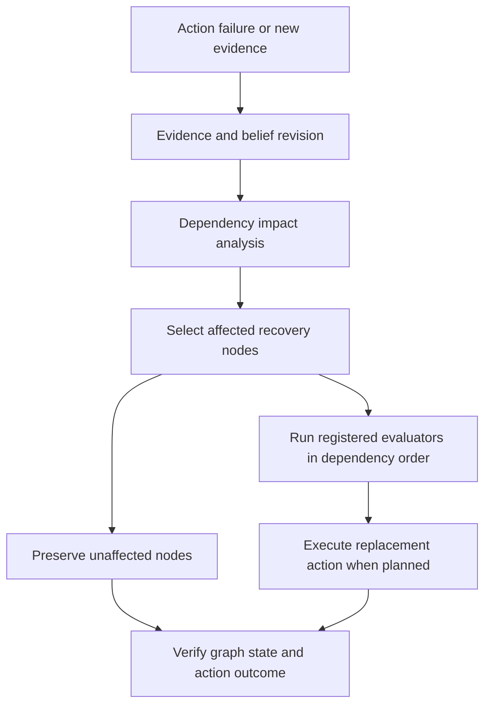

# BeliefGraph

**A belief-centric recovery prototype for multi-step AI agents.**

BeliefGraph models an agent's beliefs, conclusions, plans, and actions as a directed dependency graph. When evidence invalidates a belief or an action fails, the system can trace affected reasoning, selectively recompute registered semantic nodes, preserve unaffected branches, and verify the recovery outcome.

The project explores a practical question: **how can an agent recover from changed assumptions without blindly recomputing everything or reusing stale reasoning?**

> **Project status:** Experimental prototype. The examples demonstrate the intended workflow, but broad superiority over existing recovery systems has not been established. See [Current limitations](#current-limitations) and [Related work](#related-work).

## Contents

- [Why BeliefGraph](#why-beliefgraph)
- [How it works](#how-it-works)
- [Core capabilities](#core-capabilities)
- [Quick start: order-processing example](#quick-start-order-processing-example)
- [Compare selective recovery with a full restart](#compare-selective-recovery-with-a-full-restart)
- [Run the API and web UI](#run-the-api-and-web-ui)
- [Use the Python SDK](#use-the-python-sdk)
- [Retroactive commitment experiment](#retroactive-commitment-experiment)
- [Project structure](#project-structure)
- [Tests](#tests)
- [Current limitations](#current-limitations)
- [Related work](#related-work)

## Why BeliefGraph

Multi-step agents often derive plans and actions from assumptions that can later prove incorrect. After a source belief changes, two failure modes are possible:

- **Unnecessary recomputation:** restart the entire reasoning path even when some branches remain valid.
- **Stale reasoning:** continue using conclusions or plans derived from information that has changed.

BeliefGraph makes dependencies explicit so the recovery path can distinguish affected reasoning from independent work. It does not infer the meaning of arbitrary text; developers provide evaluators for the semantic values that need to be recomputed.

## How it works



Dependencies point from prerequisite to dependent. For semantic recomputation, registered evaluators receive the current predecessor values and return the new value for a derived node. A node's status changing is not treated as equivalent to recalculating its meaning.

## Core capabilities

- **Typed dependency graph:** Beliefs, conclusions, plans, and actions are represented as distinct node types.
- **Belief revision and impact analysis:** New evidence can trigger revision and analysis of downstream effects.
- **Selective recovery:** The recovery planner selects nodes requiring replanning instead of automatically processing every semantic node.
- **Explicit semantic evaluators:** Developers register functions that calculate derived values; BeliefGraph does not guess semantics from natural-language content.
- **Dependency-ordered execution:** Selected recovery callbacks run in topological order. If a selected prerequisite fails, dependent selected nodes are skipped.
- **Commitment-impact analysis:** The commitment components identify potentially affected commitments and recommend reconciliation actions based on recorded reversibility.
- **Replacement-action execution and verification:** The recovery flow can execute a replacement API action and verify expected graph statuses and the reported execution outcome.
- **Graph exploration UI:** The frontend includes overview, graph, impact analysis, recovery, and execution-replay views.
- **API and session storage:** A FastAPI service exposes graph operations; graph sessions are stored locally and restored by the API.

## Quick start: order-processing example

The repository includes a deterministic order-processing example. The initial action uses an outdated API version, fails against the simulated environment, and triggers belief revision and selective recovery. An independent shipping branch provides a check that unaffected semantic values remain valid.

### 1. Clone the repository

```bash
git clone https://github.com/Simi268/belief-graph.git
cd belief-graph
```

### 2. Create a Python environment and install dependencies

Python 3.10 or newer is required by the source syntax.

**Windows Command Prompt:**

```bat
python -m venv .venv
.venv\Scripts\activate.bat
python -m pip install --upgrade pip
python -m pip install -r requirements.txt
```

**macOS/Linux:**

```bash
python3 -m venv .venv
source .venv/bin/activate
python -m pip install --upgrade pip
python -m pip install -r requirements.txt
```

### 3. Run the example

Run this command from the repository root:

```bash
python -m examples.order_processing_recovery
```

The example compares selective recovery and a full-restart baseline under the same simulated API-version mismatch. Its output includes verification status, stale semantic nodes, recomputed/preserved nodes, and replacement-action outcome.

Representative output from the current scenario:

```text
BeliefGraph example: order processing
Initial failure: API_VERSION_MISMATCH (expected=v2, received=v1)
Recovery status: recovered
Semantic recomputation: completed
Replacement action succeeded: True
Semantic values correct: True
Stale nodes remaining: none
Stale semantic nodes remaining: none
Independent branch preserved: True
Recovery verified: True

Recovery comparison (same API-version failure)
Strategy             Failure                  Replacement      Semantic nodes    Preserved    Correct
-------------------------------------------------------------------------------------------------------
Selective recovery   API_VERSION_MISMATCH     succeeded        2/4 processed     2            PASS
Full restart         API_VERSION_MISMATCH     succeeded        4/4 processed     0            PASS
```

The comparison counts registered semantic `CONCLUSION` and `PLAN` nodes. The replacement action uses the existing execution path and is not counted as a semantic-value recomputation. These are measurements from this controlled example—not a general performance guarantee.

## Compare selective recovery with a full restart

The order-processing example evaluates two strategies on fresh, equivalent scenarios:

| Metric | Selective recovery | Full restart |
|---|---:|---:|
| Semantic nodes recomputed | 2 of 4 | 4 of 4 |
| Independent semantic nodes preserved | 2 | 0 |
| Semantic values correct | Pass | Pass |
| Replacement action | Succeeded | Succeeded |

In this scenario, selective recovery performs **50% fewer semantic-node evaluations**. This is a narrow result from one deterministic graph. It does not prove a 50% reduction in total runtime or the same improvement on other workloads.

## Run the API and web UI

The project also provides a FastAPI backend and a React/TypeScript frontend.

### Start the backend

From the repository root, with the Python environment activated:

```bash
python -m uvicorn app.main:app --reload --host 127.0.0.1 --port 8000
```

- API health check: <http://127.0.0.1:8000/health>
- Interactive API docs: <http://127.0.0.1:8000/docs>

### Start the frontend

Open a second terminal:

```bash
cd frontend
npm ci
npm run dev
```

Open the local URL printed by Vite (typically <http://localhost:5173>). Start the backend first so the UI can reach the API.

## Use the Python SDK

`BeliefGraphSDK` in `app/sdk.py` offers helpers for beliefs, conclusions, plans, actions, dependencies, evaluator registration, action execution, and recovery.

A minimal graph declaration looks like this:

```python
from app.models import DependencyType
from app.sdk import BeliefGraphSDK

sdk = BeliefGraphSDK()

sdk.belief("B_API", "Order API version", value="v1")
sdk.conclusion("C_ORDER", "Order can be submitted", value=None)
sdk.plan("P_SUBMIT", "Submit the order", value=None)
sdk.action("A_SUBMIT", "Call the order API", value=None)

# Edges point from prerequisite to dependent.
sdk.depends_on("B_API", "C_ORDER", DependencyType.REQUIRES)
sdk.depends_on("C_ORDER", "P_SUBMIT", DependencyType.REQUIRES)
sdk.depends_on("P_SUBMIT", "A_SUBMIT", DependencyType.REQUIRES)

@sdk.register_evaluator("C_ORDER")
def evaluate_order(node, predecessor_values):
    return {"api_version": predecessor_values["B_API"],
            "eligible": predecessor_values["B_API"] == "v2"}
```

This snippet shows graph declaration and explicit evaluation. A real recovery workflow must also register evaluators for the derived nodes it wants to recompute, provide an action environment, and supply the evidence and IDs required by `sdk.recover_from_action_failure()`. See [`examples/order_processing_recovery.py`](examples/order_processing_recovery.py) for a complete runnable workflow.

## Retroactive commitment experiment

The repository includes a deterministic experiment for a correction that arrives **after external effects have already completed**. The simulated scenario includes a compensable refund, an irreversible customer notice, an effect with unknown reversibility, and an unrelated shipment reservation.

Run it from the repository root:

```bash
python experiments/retroactive_commitment_experiment.py
```

The experiment compares three strategies:

1. **Dependency-only:** recomputes affected semantic nodes but does not track or reconcile completed commitments.
2. **Full restart:** recomputes all registered semantic conclusion/plan nodes and uses the commitment-aware reconciliation policy.
3. **BeliefGraph selective:** recomputes affected semantic nodes and uses the existing commitment resolver, impact analyzer, and reconciler.

Results from the reported local run:

| Metric | Dependency-only | Full restart | BeliefGraph selective |
|---|---:|---:|---:|
| Semantic nodes recomputed | 2 | 4 | 2 |
| Commitment-registry record visits | 0 | 16 | 16 |
| Safe scenario outcome | Fail | Pass | Pass |

The BeliefGraph strategy passed the experiment's eight scenario checks: handling the affected refund, routing irreversible/unknown effects to review, preserving the unrelated shipment, preventing duplicate compensation, recomputing the affected semantics, and retaining correct unaffected values.

The experiment demonstrates **50% fewer semantic-node evaluations than full restart for this scenario**, while both commitment-aware strategies visit the same number of registry records. It does not establish lower total processing cost or superiority over published recovery systems. The dependency-only baseline is deliberately limited and is not an implementation of REVISE, DART, or another paper.

The report and JSON output are written to:

- `experiments/reports/retroactive_commitment_experiment.md`
- `experiments/results/retroactive_commitment_experiment.json`

Run the focused tests with:

```bash
pytest -q tests/test_retroactive_commitment_experiment.py
```

## Project structure

```text
belief-graph/
├── app/
│   ├── agent.py                         # Agent runtime
│   ├── graph.py                         # Graph and dependency operations
│   ├── revision.py                      # Belief revision logic
│   ├── recovery.py                      # Recovery planning and execution
│   ├── semantic_recomputation.py        # Explicit semantic evaluators
│   ├── commitments.py                   # Commitment registry and types
│   ├── commitment_analyzer.py           # Commitment impact analysis
│   ├── commitment_dependency_resolver.py  # Commitment dependency tracing
│   ├── commitment_reconciler.py         # Compensation/review decisions
│   ├── recovery_verifier.py             # Post-recovery verification
│   ├── sdk.py                           # Developer-facing Python API
│   └── main.py                          # FastAPI service
├── examples/
│   └── order_processing_recovery.py     # Runnable recovery comparison
├── experiments/
│   ├── retroactive_commitment_experiment.py
│   ├── reports/
│   └── results/
├── frontend/                            # React + TypeScript + Vite UI
├── tests/                               # Unit and integration tests
├── requirements.txt
└── README.md
```

## Tests

Run the focused tests:

```bash
pytest -q tests/test_sdk.py tests/test_semantic_recomputation.py tests/test_recovery_engine_integration.py
pytest -q tests/test_order_processing_example.py
pytest -q tests/test_retroactive_commitment_experiment.py
```

Run the full Python test suite:

```bash
pytest -q
```

## Current limitations

- **Experimental prototype:** This project is not presented as a production-ready agent runtime.
- **Explicit semantics:** Developers must register evaluators for the derived node values that need recomputation. Arbitrary reasoning semantics are not inferred from node text.
- **Commitment persistence:** The commitment registry is in-memory; the current experiment does not establish persistence of commitments across process restarts.
- **External verification:** The reconciler requires a compensation callback to return verification evidence. A production integration must independently check the external system's actual state.
- **Registry work:** Commitment-aware strategies visit the same number of commitment-registry records in the current experiment; selective semantic recomputation does not reduce that work today.
- **Scope of evaluation:** The examples are deterministic and limited. They do not establish performance, safety, or superiority across diverse production workloads.
- **Novelty:** Dependency-aware recovery, belief revision, and commitment-sensitive recovery are active areas with related existing work. This repository does not claim to have invented selective recovery, and the experiment has **not established research-level differentiation** from existing systems.

## Related work

These projects and papers address related problems. This list is selective, not an exhaustive literature review or a head-to-head comparison.

- [REVISE: Validity-Guided Recovery for Online Revisions in Agent Workflows](https://arxiv.org/abs/2609.00643) — dependency-aware recovery for workflow revisions.
- [DART: Semantic Recoverability for Structured Tool Agents](https://arxiv.org/abs/2605.23311) — safe recovery when dependent work has already been committed.
- [Corollary](https://github.com/gabe-santana/corollary) — a belief-based agent runtime with dependency-driven retraction and verification.
- [UndoBench](https://github.com/tradertanmay/undobench) — evaluates recovery capability and side-effect safety in tool-using agents.

## Research and project status

BeliefGraph is retained as an engineering prototype and evaluation artifact. The current experiment shows that its existing components can be composed for the defined simulated scenario, but **a distinct advantage over the closest existing approaches has not been demonstrated**. Further development as a novel recovery framework should wait until a direct, evidence-based comparison identifies a specific gap.

## License

No license file was present in the reviewed project archive. Until a license is added to the repository, do not assume that the code is open-source licensed for reuse.
