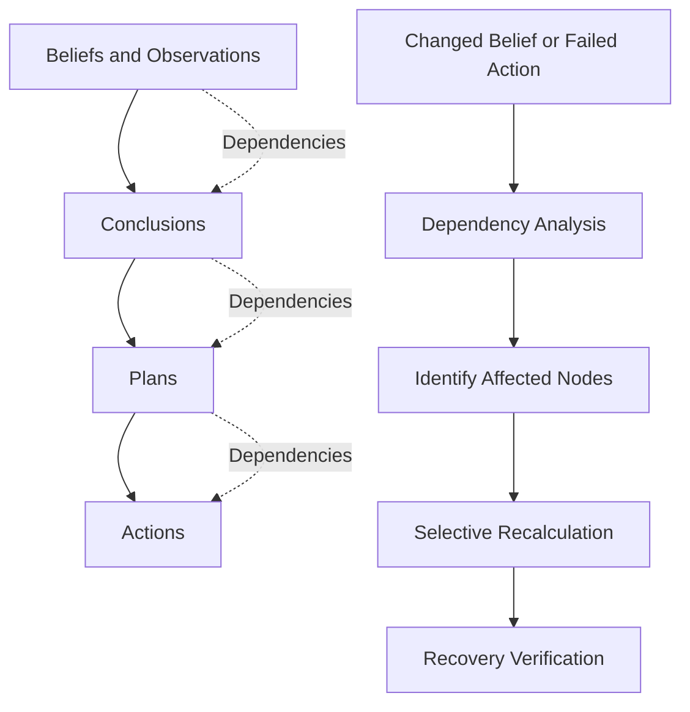

# BeliefGraph

### Dependency-Aware Recovery for AI Agents

BeliefGraph helps developers understand how an AI agent's beliefs, conclusions, plans, and actions depend on one another—and recover intelligently when something changes.

When an assumption becomes invalid or an action fails, BeliefGraph traces the affected dependencies, selectively recomputes registered semantic nodes, and verifies the recovery while preserving unaffected branches.

**Instead of restarting everything, recover what actually needs to change.**

Built with Python, FastAPI, React, and TypeScript.

---

## The Problem

AI agents often perform tasks through multiple dependent steps. A single change can invalidate conclusions and plans built on top of an earlier assumption.

Without explicit dependency tracking, developers may struggle to determine:

- Which conclusions became invalid after a change.
- Which plans and actions need to be recomputed.
- Which parts of an execution remain valid.
- Whether recovery completed correctly.
- How to reproduce and investigate a failure.

BeliefGraph makes these dependencies explicit so developers can trace the impact of changes and perform targeted recovery.

## How It Works

BeliefGraph represents an agent's reasoning and execution state as a dependency graph.



When a change occurs, BeliefGraph:

1. **Tracks dependencies** between beliefs, conclusions, plans, and actions.
2. **Identifies affected nodes** whose validity may have changed.
3. **Propagates invalidation** through relevant dependencies.
4. **Recomputes selected nodes** using registered semantic recomputation logic.
5. **Preserves unaffected branches** instead of automatically recomputing the entire graph.
6. **Verifies recovery** and exposes the resulting state for inspection.

The goal is to make recovery more targeted, traceable, and easier to debug.

## Key Features

- **Dependency Graph:** Represent relationships between beliefs, conclusions, plans, and actions.
- **Change Impact Analysis:** Trace which dependent nodes may be affected by a changed assumption or failed action.
- **Selective Recovery:** Recompute affected semantic nodes instead of automatically restarting the entire graph.
- **Failure Propagation:** Track how invalidation can propagate through dependent nodes.
- **Recovery Verification:** Inspect whether the recovery process completed successfully.
- **Execution Inspection:** Explore graph state and recovery outcomes through the API and web interface.
- **Python SDK:** Integrate graph and recovery functionality into Python workflows.
- **Automated Tests:** Validate graph behavior, recovery logic, and related functionality.

---

## Quick Start

### Prerequisites

- Python 3.10 or later
- Git
- Node.js and npm, if you want to run the frontend separately

### 1. Clone the repository

```bash
git clone https://github.com/Simi268/belief-graph.git
cd belief-graph
```

### 2. Create a virtual environment

**Windows:**

```powershell
python -m venv .venv
.venv\Scripts\activate
```

**macOS / Linux:**

```bash
python -m venv .venv
source .venv/bin/activate
```

### 3. Install dependencies

```bash
python -m pip install -r requirements.txt
```

### 4. Start the API

```bash
uvicorn app.main:app --reload
```

The API will be available at:

- **API:** http://127.0.0.1:8000
- **Interactive API documentation:** http://127.0.0.1:8000/docs
- **Health check:** http://127.0.0.1:8000/health

---

## Run with Docker

BeliefGraph can also be built and run inside a Docker container.

### 1. Build the image

```bash
docker build -t beliefgraph:local .
```

### 2. Start the API

```bash
docker run -d --name beliefgraph-api -p 8000:8000 beliefgraph:local
```

### 3. Check the service

Open:

http://localhost:8000/health

You can also use:

```bash
curl http://localhost:8000/health
```

### 4. Run the test suite

Run the tests in a separate container:

```bash
docker run --rm beliefgraph:local python -m pytest -q
```

The test suite has passed **379 tests** in a clean Docker build from a fresh GitHub checkout.

### 5. Stop the API

```bash
docker rm -f beliefgraph-api
```

**Note:** The image includes project files copied during the Docker build. Runtime data persistence depends on how storage is configured and whether persistent volumes are mounted.

---

## Example: Recovering from an API Version Change

Consider an agent processing an order.

The agent has already checked inventory, pricing, and shipping requirements. It then attempts to create an order using an API version that is no longer accepted.

A full restart could repeat all previous checks. BeliefGraph instead uses the dependency graph to identify the semantic nodes affected by the failure.

### Example workflow

1. The agent attempts an operation with an outdated API version.
2. The operation fails with an API version mismatch.
3. BeliefGraph identifies the affected dependencies.
4. The registered recomputation logic updates the relevant semantic nodes.
5. The agent retries using the replacement action.
6. The recovery process verifies the resulting state.

### Representative result

In the included order-processing recovery scenario:

| Metric | Selective Recovery | Full Restart |
|---|---:|---:|
| Semantic nodes processed | 2 of 4 | 4 of 4 |
| Unaffected semantic nodes preserved | 2 | 0 |
| Recovery outcome | Successful | Successful |

Both approaches succeed in this scenario. Selective recovery processes fewer semantic nodes while preserving the unaffected branch.

These results describe one controlled example, not a guarantee of improved performance for every agent or workload.

### Run the example

```bash
python -m examples.order_processing_recovery
```

The example demonstrates the recovery workflow, including the detected failure, recomputed nodes, preserved nodes, and recovery verification.

---

## Python SDK

BeliefGraph also provides Python interfaces for working with dependency graphs and recovery operations.

A simplified illustration of the integration concept:

```python
# Illustrative workflow; use the actual SDK interfaces
# and registered semantic functions provided by the repository.

# 1. Build a graph of beliefs, conclusions, plans, and actions.
# 2. Register dependencies between nodes.
# 3. Execute the workflow.
# 4. Report a changed belief or failed action.
# 5. Run recovery and inspect the resulting graph state.
```

For a working implementation, see the SDK examples and source code in the repository.

---

## Frontend

BeliefGraph includes a React and TypeScript frontend for interacting with the application.

To run it locally, open a second terminal:

```bash
cd frontend
npm install
npm run dev
```

Use the development URL printed by Vite.

Ensure the backend API is running and configure the frontend's API endpoint according to the project's existing configuration.

---

## Project Structure

```text
belief-graph/
├── app/          # API and core application logic
├── examples/     # Demonstration workflows
├── experiments/  # Experimental scenarios and evaluations
├── tests/        # Automated tests
├── data/         # Project data
├── frontend/     # React and TypeScript interface
├── Dockerfile
├── .dockerignore
├── requirements.txt
└── README.md
```

---

## Current Scope

BeliefGraph is an engineering prototype for dependency-aware recovery in multi-step AI agent workflows.

Its recovery behavior depends on the graph structure, registered dependencies, and available semantic recomputation logic. It does not automatically understand every agent's reasoning or replace the execution framework itself.

The current implementation focuses on:

- Explicit dependency representation.
- Change impact and invalidation propagation.
- Selective semantic recomputation.
- Preservation of unaffected graph branches.
- Recovery verification and automated testing.

The included examples and tests demonstrate implemented behavior. Broader performance, scalability, and effectiveness claims require evaluation across additional workloads.

---

## Contributing

Contributions, bug reports, and suggestions are welcome.

If you find an issue or have an idea for improving dependency tracking or recovery, open a GitHub issue or submit a pull request.

---

